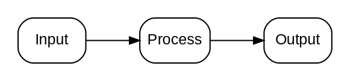
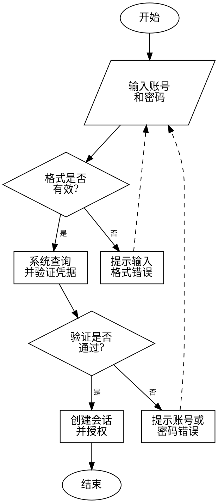
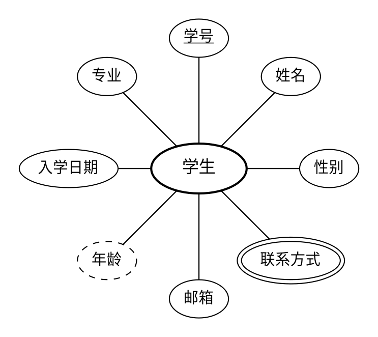

# Graphviz Diagrams

## Quick Start

- Prefer producing editable `.dot` or `.gv` source first, then render an image when Graphviz is available.
- Before creating or revising a diagram, read the matching example file when one exists:
  - Chinese academic flowchart: `examples/flowchart-academic-login-cn.dot`
  - Classic Chen-style radial entity-attribute diagram: `examples/chen-er-radial-entity-cn.dot`
- Use the relevant example as the starting pattern for layout, shapes, font choices, spacing, and validation. If no example matches the request, state that no exact bundled example exists and proceed from the style defaults.
- Use `scripts/render_graphviz.py` to validate or render diagrams:

```sh
python3 scripts/render_graphviz.py path/to/diagram.dot --format png
python3 scripts/render_graphviz.py path/to/diagram.gv --layout neato --format svg --output path/to/diagram.svg
python3 scripts/render_graphviz.py path/to/diagram.dot --check-only
```

- Default to monochrome, high-contrast diagrams unless the user asks for color.
- Keep labels short. Move prose explanations outside the graph or into a small legend node.
- For large graphs, group, filter, or split the diagram before relying on Graphviz layout.

## Diagram Choices

- Use `digraph` and `->` for directed flows, dependencies, state transitions, pipelines, and architecture data flow.
- Use `graph` and `--` for undirected relationships, similarity maps, peer networks, and simple associations.
- Use `rankdir=LR` for process flows, dependency chains, and architecture diagrams that read left to right.
- Use `rankdir=TB` for hierarchy, organization, and tree-like diagrams.
- Use `subgraph cluster_name` only for meaningful groups such as modules, services, phases, or trust boundaries.
- Use layout engine `dot` for hierarchical graphs, `neato` or `fdp` for relationship maps, `sfdp` for larger undirected graphs, `twopi` for radial hierarchy, and `circo` for circular relationships.

## Style Defaults

Start from a simple base and adjust only when the task requires it:



- For paper or report diagrams, prefer white background, black lines, readable spacing, and no decorative gradients.
- Avoid encoding essential meaning only through color; use labels, shapes, or line styles as well.
- Keep edge labels sparse. Too many labeled edges usually means the graph should be simplified.
- Use stable IDs in ASCII when possible, and put human text in `label`.

## Flowchart Example

Use this pattern when the user asks for a Chinese academic flowchart. Before drafting, read `examples/flowchart-academic-login-cn.dot` and follow it for layout, shapes, margins, manual line breaks, and retry edges. Use `digraph`, `rankdir=TB`, ellipse start/end nodes, parallelogram input/output nodes, diamond decision nodes, box processing/error nodes, and dashed back edges for retries. Keep Chinese labels short and use manual `\n` line breaks to avoid over-wide boxes.



## Chinese Labels

- DOT source may contain Chinese labels directly when saved as UTF-8.
- Set a local Chinese font when rendering Chinese text, for example:

```dot
graph [fontname="PingFang SC"];
node [fontname="PingFang SC"];
edge [fontname="PingFang SC"];
```

- On macOS, common choices include `PingFang SC`, `Songti SC`, and `Heiti SC`.
- If Chinese text renders as boxes or missing glyphs, switch the `fontname` explicitly before changing the diagram structure.

## Chen ER Radial Example

Use this as the default pattern when the user asks for a classic Chen-style local entity-attribute diagram. Before drafting, read `examples/chen-er-radial-entity-cn.dot` and follow it for fixed radial placement, ellipse-only entity/attribute shapes, and line style conventions. Keep the central entity and attributes as ellipses, place attributes around the entity in all directions, underline key attributes, use `peripheries=2` for multivalued attributes, and use dashed ellipses for derived attributes. Render this fixed-position pattern with `--layout neato`.



## Oversize Control

- If a graph has more than about 30 nodes or many crossing edges, first reduce scope, cluster related nodes, or create multiple diagrams.
- For dense dependency graphs, show only the selected component, direct neighbors, and important external boundaries.
- For architecture diagrams, prefer 5-9 main nodes per view and use clusters for domains instead of drawing every class or function.
- For workflow diagrams, split overview and detail views when labels or edge crossings make the rendered result hard to read.

## Validation

- Always validate DOT syntax before final delivery when Graphviz is available:

```sh
python3 scripts/render_graphviz.py path/to/diagram.dot --check-only
```

- When rendering, inspect failures for Graphviz syntax messages. Common issues are missing semicolons, unquoted labels with spaces, mismatched braces, or using `->` inside `graph` instead of `digraph`.
- If Graphviz is unavailable, still deliver the editable DOT source and explain that rendering could not be verified locally.

## Resource

- `scripts/render_graphviz.py`: validate and render `.dot` or `.gv` files to `png`, `svg`, or `pdf` using a selected Graphviz layout engine.
- `examples/flowchart-academic-login-cn.dot`: required starting example for Chinese academic flowcharts.
- `examples/chen-er-radial-entity-cn.dot`: required starting example for classic Chen-style radial entity-attribute diagrams.
